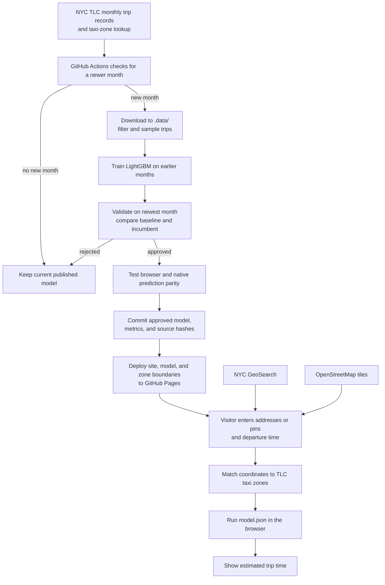

# Taxi-Minute

**An end-to-end MLOps project for NYC yellow-taxi trip-time prediction.** It takes public monthly trip records through data checks, time-based training and validation, model promotion, automated deployment, and browser inference. The user-facing map lets someone search addresses or place pins, choose a departure time, and get an estimated duration.

**[Try the live website](https://codewithdaniel1.github.io/taxi-minute/)** · [See the current model and data months](site/metadata.json) · [View weekly runs](https://github.com/codewithdaniel1/taxi-minute/actions/workflows/update-and-deploy.yml)

## System design and MLOps lifecycle

This single diagram follows the system from TLC data to a visitor's prediction. [Open it separately](docs/architecture.mmd) to use GitHub's zoom and pan controls.



The weekly job skips deployment when nothing changes. A manual run redeploys the current site even without a new model. The taxi-zone boundary file is built separately from TLC's zone shapefile and committed to the site; it is not regenerated by the weekly job.

| Stage | Implemented in this repo |
| --- | --- |
| Data ingestion and checks | Discover TLC monthly files, download to an ignored cache, filter invalid trips, and sample deterministically. |
| Training and evaluation | Train LightGBM on earlier months; validate on the newest month against a route-median baseline and the deployed model. |
| Release gate | Publish only if quality thresholds pass and browser predictions match native LightGBM on held-out cases. |
| Versioning and deployment | Commit the model, metrics, source URLs and hashes; GitHub Actions deploys the static site to Pages. |
| Operations | Check workflow runs and the model validation month; manually rerun or restore a prior Git commit when needed. |

The model uses only information available before a ride: taxi zones and departure date and time. It does not use metered trip distance or live traffic. [Data and model](docs/data-and-model.md) explains the exact checks and metrics; [operations](docs/operations.md) explains automation, inspection, and recovery.

## Project map

| Path | Purpose |
| --- | --- |
| [`site/`](site/) | Static map website, browser model, taxi-zone boundaries and names, and current model metadata |
| [`src/taxi_minute/`](src/taxi_minute/) | TLC discovery, download, filtering, and feature encoding |
| [`scripts/update.py`](scripts/update.py) | Train, evaluate, and publish an approved model |
| [`scripts/build_zone_boundaries.py`](scripts/build_zone_boundaries.py) | Convert the official TLC shapefile into browser-ready zone boundaries |
| [`models/champion.txt`](models/champion.txt) | Native LightGBM model for the next update's comparison |
| [`tests/`](tests/) | Browser versus native model prediction checks |
| [`.github/workflows/update-and-deploy.yml`](.github/workflows/update-and-deploy.yml) | Weekly update, tests, commit, and Pages deployment |
| [`.data/`](docs/data-and-model.md#where-the-data-lives) | Local download cache, created on demand and ignored by Git |

There is no tracked `data/` folder. Downloaded trip files go into `.data/` when you run training locally; GitHub Actions creates its own temporary cache on each run. Raw trip files are never committed. The committed browser model, boundaries, and metadata are the website's deployable artifacts. The native model, parity cases, and lockfile support reliable updates and checks.

## Run locally

Install [uv](https://docs.astral.sh/uv/) and Node.js 20 or newer. From the repository root:

```sh
uv sync
uv run python scripts/update.py
npm test
python3 -m http.server 8000 --directory site
```

Open <http://localhost:8000>. If no newer TLC month is available, the update command exits without changing the model; use `--force` to retrain with the latest four published months. The first training run downloads four Parquet files and can take several minutes. See [operations](docs/operations.md) for manual runs, automation, and troubleshooting.

## Release status and scope

The website shows the validation month and error for the model it serves. [`site/metadata.json`](site/metadata.json) records training and validation months, row counts, metrics, source URLs, and SHA-256 hashes; it is updated whenever a new model is promoted. The [GitHub Actions workflow](.github/workflows/update-and-deploy.yml) is scheduled for Mondays at 08:17 UTC. It checks for a newer TLC month and only commits a model that passes the quality gates. It deploys the site when a model changes; a manual run also redeploys it. The site remains available with the last published model when no new model is promoted.

GitHub [may delay or drop scheduled runs and disables scheduled workflows in public repositories after 60 days without repository activity](https://docs.github.com/en/actions/reference/workflows-and-actions/events-that-trigger-workflows#schedule). This setup cannot guarantee unattended updates for months. Check the [run history](https://github.com/codewithdaniel1/taxi-minute/actions/workflows/update-and-deploy.yml) and [current model metadata](site/metadata.json); see [operations](docs/operations.md) for recovery steps.

Predictions cover historical NYC yellow-taxi trips between TLC taxi zones, with supported trip durations of 2–120 minutes. Addresses and pins select zones, so two addresses in the same zones at the same departure time get the same prediction. They are planning estimates, not promises for a particular street address or traffic condition. [Read the model limitations](docs/data-and-model.md#limitations).

This project records batch validation metrics and workflow results. It does not yet collect live prediction outcomes or send failure alerts; model freshness and workflow health require checking GitHub Actions and the published metadata.
